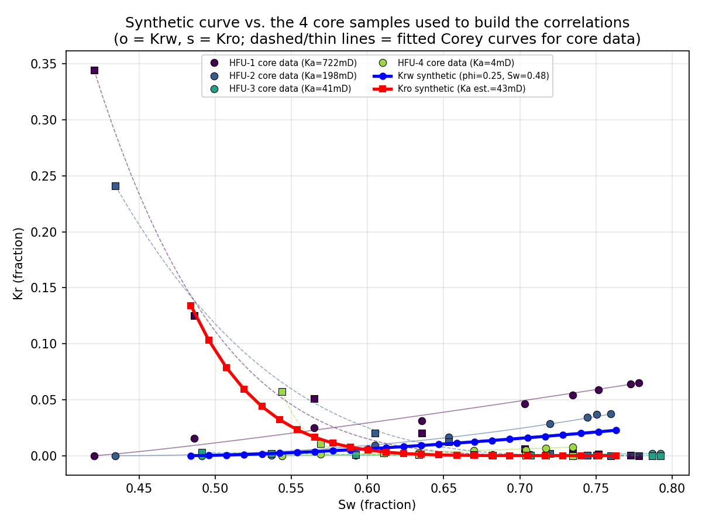

# Synthetic Water–Oil Relative Permeability from Logs

Generate a deterministic Corey-type relative permeability curve using **only porosity ($\phi$) and water saturation ($S_w$) from open-hole logs** — no absolute permeability and no free-water level required.

The chain has three steps, calibrated against four HFU core samples with known $K_a$, $\phi$, $S_{wir}$, and full $K_{rw}$/$K_{ro}$ vs. $S_w$ curves.

---

## Step 1 — Permeability from porosity and irreducible saturation

A Timur-type transform fitted to the core samples:

$$
\ln(K_a) = 2.4459\,\ln(\phi) - 15.9798\,\ln(S_{wir}) - 4.5777
$$

$S_w$ from the log is treated as $\approx S_{wir}$, so the depth used should be at or near irreducible saturation — not inside an active transition zone.

## Step 2 — Corey parameters as functions of permeability

Each of the six shape parameters is linear in $\log_{10}(K_a)$:

$$
\begin{aligned}
S_{wir}    &= -0.0570\,\log_{10}(K_a) + 0.5772 \\[4pt]
S_{or}     &= -0.0147\,\log_{10}(K_a) + 0.2608 \\[4pt]
K_{rw}^{\max} &= \phantom{-}0.0254\,\log_{10}(K_a) - 0.0189 \\[4pt]
K_{ro}^{\max} &= \phantom{-}0.1354\,\log_{10}(K_a) - 0.0871 \\[4pt]
n_w        &= \phantom{-}0.0636\,\log_{10}(K_a) + 1.3905 \\[4pt]
n_o        &= -3.1524\,\log_{10}(K_a) + 11.2621
\end{aligned}
$$

## Step 3 — The Corey relative permeability curves

Normalized water saturation:

$$
S_{wn} = \frac{S_w - S_{wir}}{1 - S_{wir} - S_{or}}
$$

$$
K_{rw}(S_w) = K_{rw}^{\max}\, S_{wn}^{\,n_w}
\qquad
K_{ro}(S_w) = K_{ro}^{\max}\, (1 - S_{wn})^{\,n_o}
$$

---

## The full chain

$$
\phi,\ S_w
\;\xrightarrow{\ \text{Step 1}\ }\;
K_a
\;\xrightarrow{\ \text{Step 2}\ }\;
\{S_{wir},\, S_{or},\, K_{rw}^{\max},\, K_{ro}^{\max},\, n_w,\, n_o\}
\;\xrightarrow{\ \text{Step 3}\ }\;
K_{rw}(S_w),\ K_{ro}(S_w)
$$

## A note on log bases

Step 1 uses the **natural log** ($\ln$), while Step 2 uses **base-10 log** ($\log_{10}$). That is exactly how the two regressions were independently fit in the script — not a typo. If you reimplement this by hand or in another tool, keep the distinction or the numbers will not reproduce.

---

## Usage

```bash
python src/synthetic_relperm_simple.py
```

Edit `phi_input` and `Sw_input` in the `__main__` block, or import the function directly:

```python
from synthetic_relperm_simple import generate_synthetic_relperm

Sw_grid, Krw, Kro, Ka_est, params = generate_synthetic_relperm(phi=0.25, Sw=0.48)
```

Returns the saturation grid, both relative permeability curves, the estimated $K_a$ in mD, and the predicted Corey parameters.

## Output



The highlighted curves are the synthetic prediction; the markers and thin lines are the four core samples and their fitted Corey curves ($\circ$ = $K_{rw}$, $\square$ = $K_{ro}$).

## Layout

| Path | Contents |
| --- | --- |
| [src/synthetic_relperm_simple.py](src/synthetic_relperm_simple.py) | Calibration data, fitting, and curve generation |
| [images/](images/) | Generated plot |
| [data/](data/) | Calibration source (`Result_Summary_KwKo_YKN.xlsx`) |
